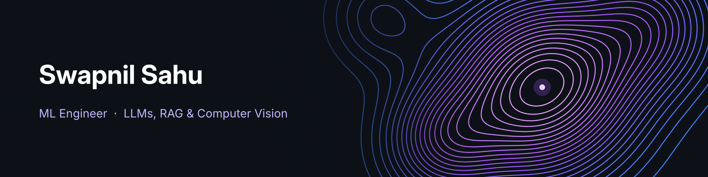

  
  
  

I fine-tune, evaluate and ship language and vision models, from LoRA fine-tuning on an A100 to full agent and RAG systems that run on a 6 GB consumer GPU. Every choice is picked with numbers, every experiment is tracked, and every request is traced, so I can show what actually improved and why.

Eager to bring this benchmark-driven approach to production-scale AI systems and complex engineering challenges.

## How I work

**⚡ Hardware-aware.** I match the method to the machine: LoRA on an A100 in industry, and QLoRA, Unsloth and memory-saving DPO (the adapter-disabled policy doubles as the reference model) on consumer GPUs. All of my portfolio systems run end-to-end on 6 GB of VRAM.

**🧪 Measured, not guessed.** I use frozen test sets, hand-labelled golden sets, identical scoring across baselines, and significance tests, with runs tracked in MLflow. I also test the test itself: I found a train/serve window mismatch only by evaluating the exported ONNX model on streaming data, and I caught Ollama's KV-cache reuse inflating prefill timings by about 10×.

**📊 Observable by default.** Structured per-request logs, per-stage latency and token metrics, readiness endpoints, OpenTelemetry traces in Grafana correlated by `trace_id`, and Langfuse for LLM calls.

## Selected results

| Work | Result | Context |
|---|---|---|
| **Enterprise chatbot** · Logic Fruit | **BERTScore 71% → 87%**, **faithfulness 82% → 97%** | Gemma 3 270M + LoRA on a 10k-pair instruction dataset built from internal data. F1 78% → 92%, ROUGE 28% → 45% |
| **Drone vs. bird** · radar | **97% accuracy** on 5 s windows, **90%+** on every 1–16 s window | 5+ engineered trajectory features, 4 classifiers benchmarked. Retrained after finding a train/serve window mismatch, then shipped as ONNX |
| **Toolcaller-SLM** | **61.6% → 80.0%** exact match, **0% → 82%** correct abstention | 0.5B model, SFT + DPO on its own mistakes, 2,929 held-out questions, p = 0.0003 |
| **OKF** | **89% vs. 26%** fully answered | Section-based hybrid retrieval vs. GraphRAG, at 20× lower build cost |
| **PDFinsights** | **97% Hit@5**, **290 ms** to first token | Hybrid search + reranking. llama3.2:3b picked from 5 LLMs on speed and faithfulness |

## Experience

**AI & ML Intern, [Logic Fruit Technologies](https://www.logic-fruit.com/)** · Gurugram · Apr 2025 – Apr 2026

- **Enterprise knowledge chatbot:** turned unstructured internal data into a 10,000-pair instruction dataset and fine-tuned Gemma 3 270M with LoRA on an A100. Built a human-in-the-loop feedback store in PostgreSQL for future preference tuning.
- **Drone vs. bird classification from radar:** engineered kinematic and trajectory features from 3D radar tracks and benchmarked SVM, Random Forest, XGBoost and LSTM in MLflow. An RF + XGBoost ensemble reached 96% on 16 s windows. After finding a train/serve window mismatch, I retrained and shipped a 5 s ONNX model at 97%, holding 90%+ across 1–16 s windows.
- **Synthetic ISAR imaging for DRDO:** generated synthetic radar images from 3D satellite and debris meshes, and designed a CNN for space-object recognition with synthetic-to-real domain adaptation.
- **Real-time PPE detection:** built a semi-supervised auto-labelling pipeline and fine-tuned YOLO for edge deployment on an Intel Agilex 7 FPGA.

## Projects

| Project | What it is | Stack |
|---|---|---|
| **[Toolcaller-SLM](https://github.com/SwapnilS-15/Toolcaller-SLM)** [model](https://huggingface.co/SwapnilS-15/qwen2.5-0.5b-instructv2-fc) · [live demo](https://huggingface.co/spaces/SwapnilS-15/toolcaller-demo) | A 0.5B function-calling model that knows when *not* to call a tool. I audited xLAM-60k (812 broken labels, 367 duplicates, 133 leaks removed), then trained QLoRA SFT and DPO. It's served with vLLM behind a guarded LangGraph gateway, with CI and an eval regression gate. | `TRL` `Unsloth` `vLLM` `LangGraph` `Langfuse` |
| **[OKF](https://github.com/SwapnilS-15/OKF)** | A local multi-agent research assistant over 5 landmark AI papers. It gives cited answers, searches arXiv and writes reports. Four LangGraph agents talk over A2A + MCP, with guardrails against prompt injection and made-up citations. | `LangGraph` `A2A` `MCP` `Qdrant` `DeepEval` |
| **[Enterprise-RAG](https://github.com/SwapnilS-15/Enterprise-RAG)** | Observable document Q&A over PDF, DOCX and XLSX, with hybrid search, ColBERT reranking, page-level citations and a tool-calling agent. Traces and metrics go to Grafana, and evaluations to MLflow. | `FastAPI` `Qdrant` `OpenTelemetry` `Grafana` `MLflow` |
| **[PDFinsights](https://github.com/SwapnilS-15/PDFinsights)** | Local PDF question answering where every choice is measured, from retrieval to model selection. It has a streaming FastAPI backend and a Streamlit UI, and ships with Docker, Kubernetes and CI. | `FastAPI` `ChromaDB` `Ollama` `DeepEval` `K8s` |

**In progress:** vision-language work with **SigLIP**, and **diffusion models**.

## Stack

  
  
  
  
  
  
  
  
  
  
  

**LLMs & training:** PyTorch · Transformers · TRL (SFT, DPO) · PEFT / LoRA / QLoRA · Unsloth · vLLM · Ollama
**Agents & RAG:** LangGraph · LangChain · MCP · A2A · Qdrant · ChromaDB · hybrid search · reranking
**Vision & classical ML:** YOLO · ResNet · CNNs · OpenCV · scikit-learn · XGBoost · ONNX
**Eval & observability:** MLflow · DeepEval · Langfuse · OpenTelemetry · Grafana
**Backend & deployment:** FastAPI · PostgreSQL · Docker · Kubernetes · GitHub Actions

**Certifications:** AWS Certified AI Practitioner · Microsoft Azure AI Fundamentals · Google Cloud Fundamentals
